# Captures d’écran

Annexe du document [Documentation et rapport du projet MDD](../documentation-projet.md).

Cette annexe a pour but de montrer les vues principales de MDD, sur ordinateur (1440 × 900) et sur mobile (375 × 812), avec les composants Angular qui les composent. Les captures sont prises sur la build de production, avec des données de démonstration.

## Accueil, inscription et connexion

Composant `Home` pour l’accueil ; composants `Register` et `Login` pour les formulaires, dans la mise en page `AuthLayout`, avec la flèche de retour `BackLink`.

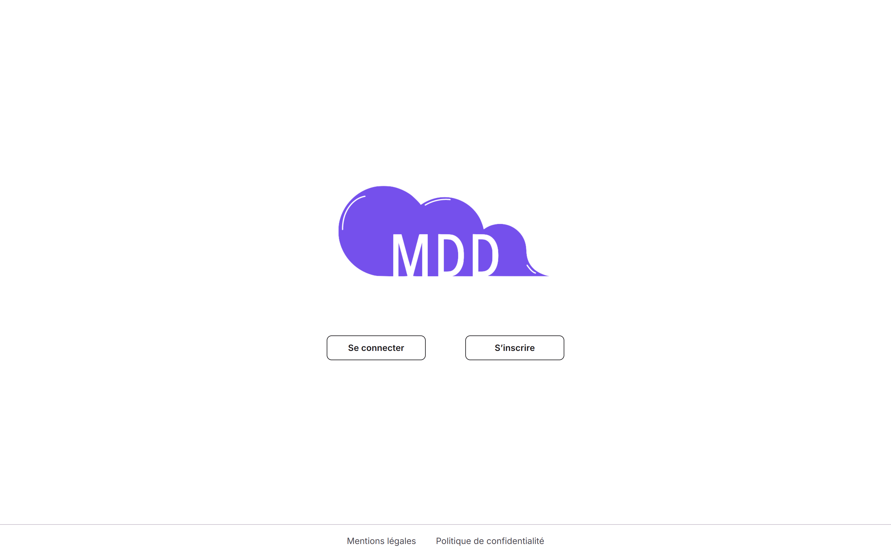

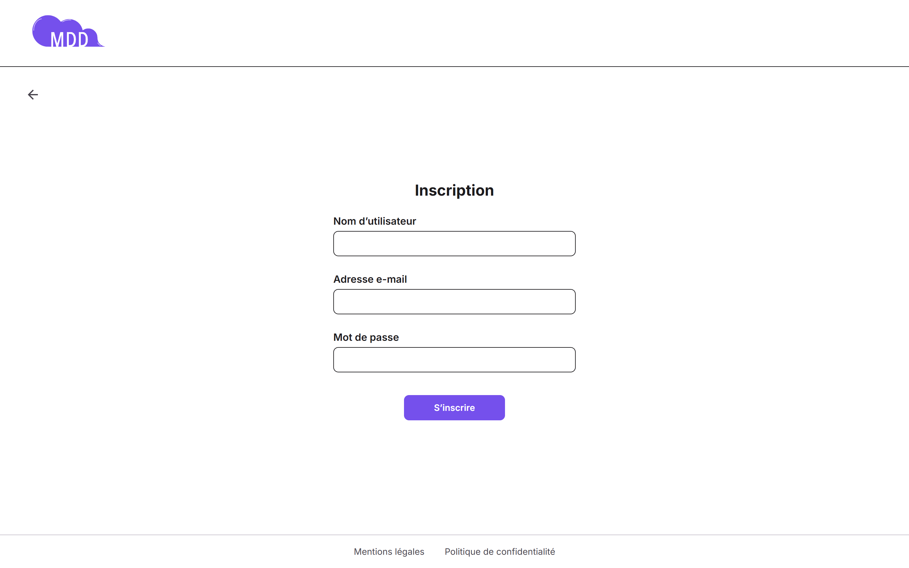

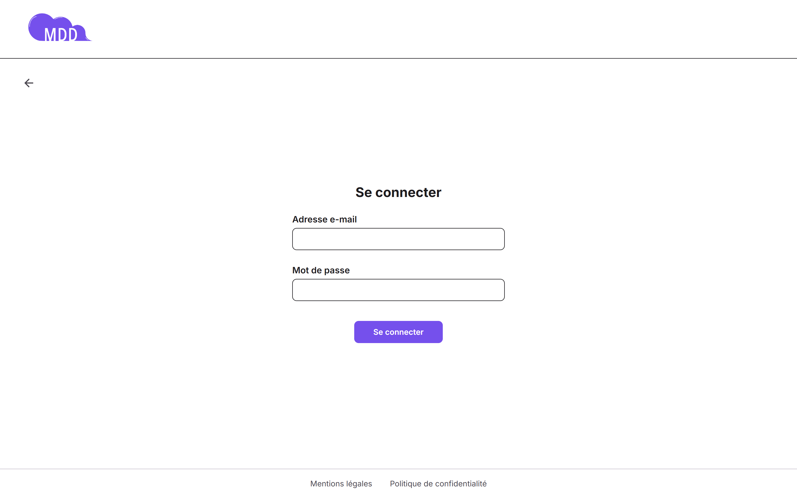

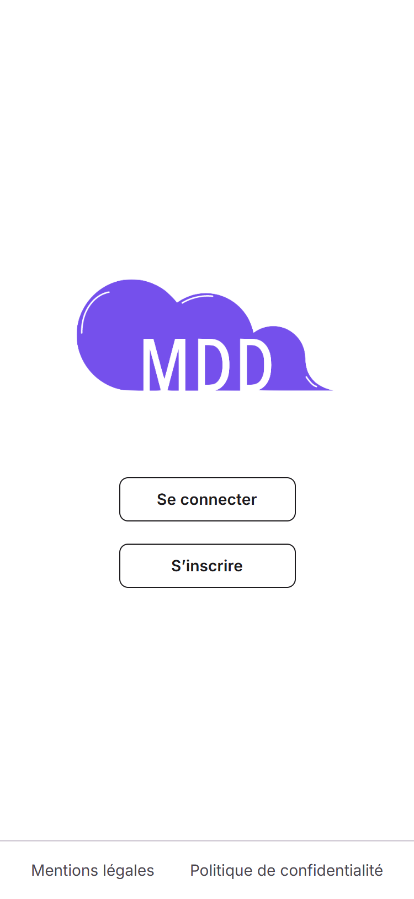 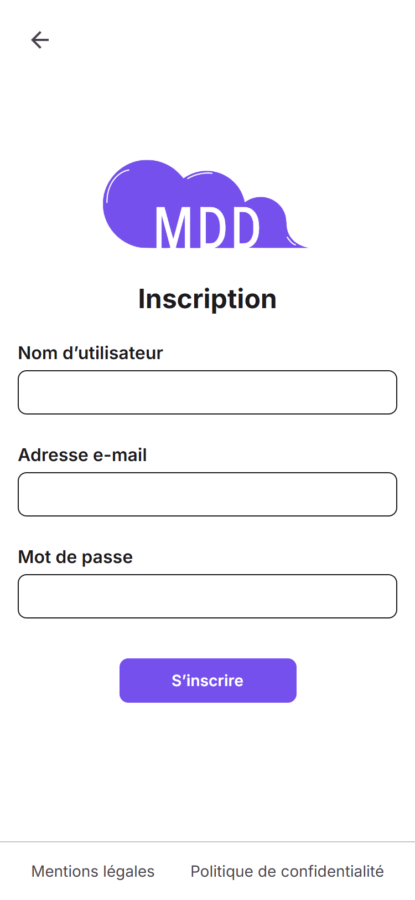 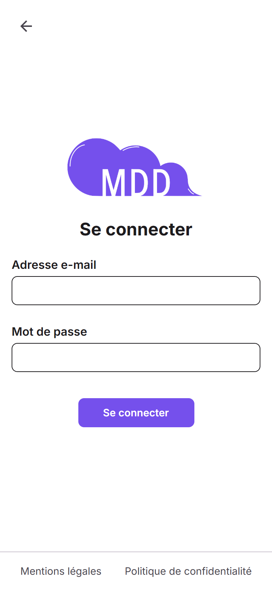

## Fil d’actualité

Composant `Feed`, qui affiche une carte `PostCard` par article, dans la mise en page `MainLayout` : sous 768 px de large, son bandeau replie la navigation dans un menu ☰, ouvert en panneau latéral.

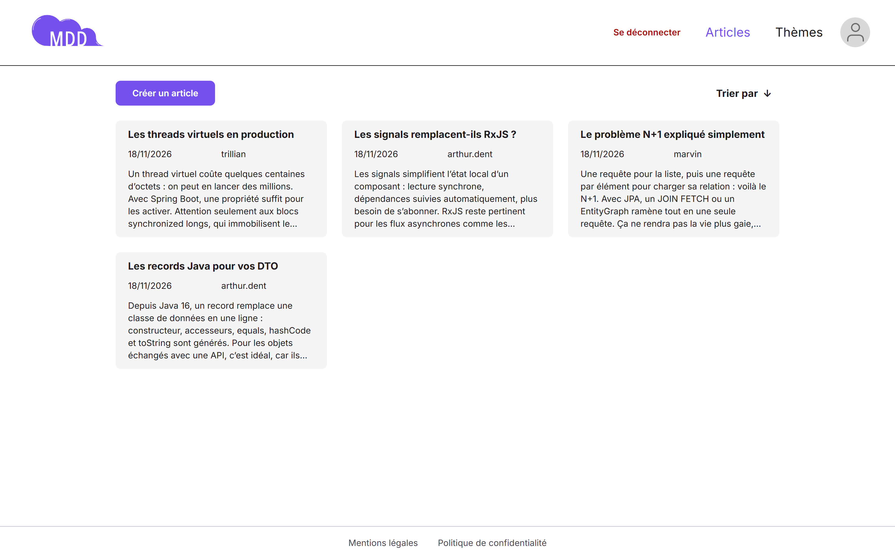

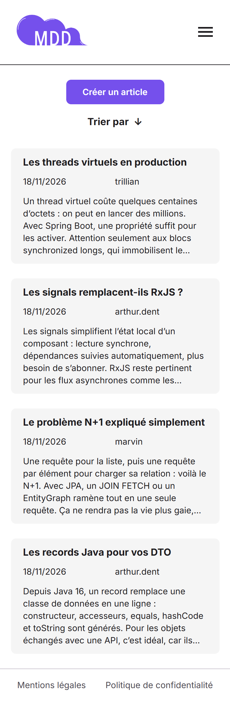 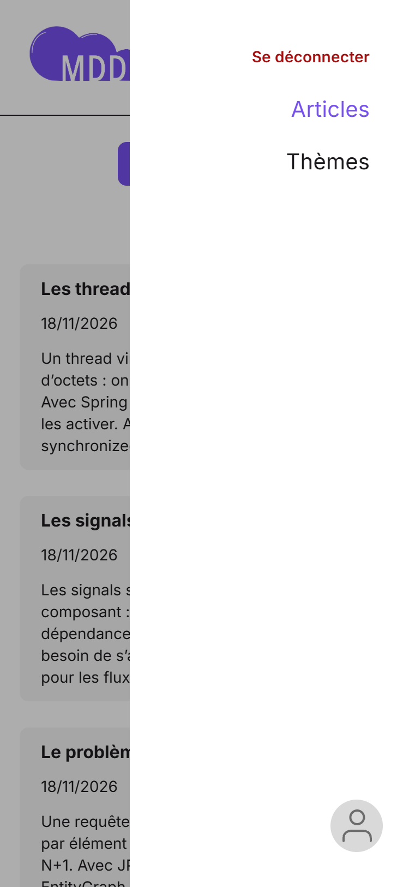

## Article et création d’article

Composant `PostDetail` pour la lecture, avec la liste et le formulaire des commentaires dans `Comments` ; composant `PostCreate` pour la création, dont la liste ne propose que les thèmes suivis.

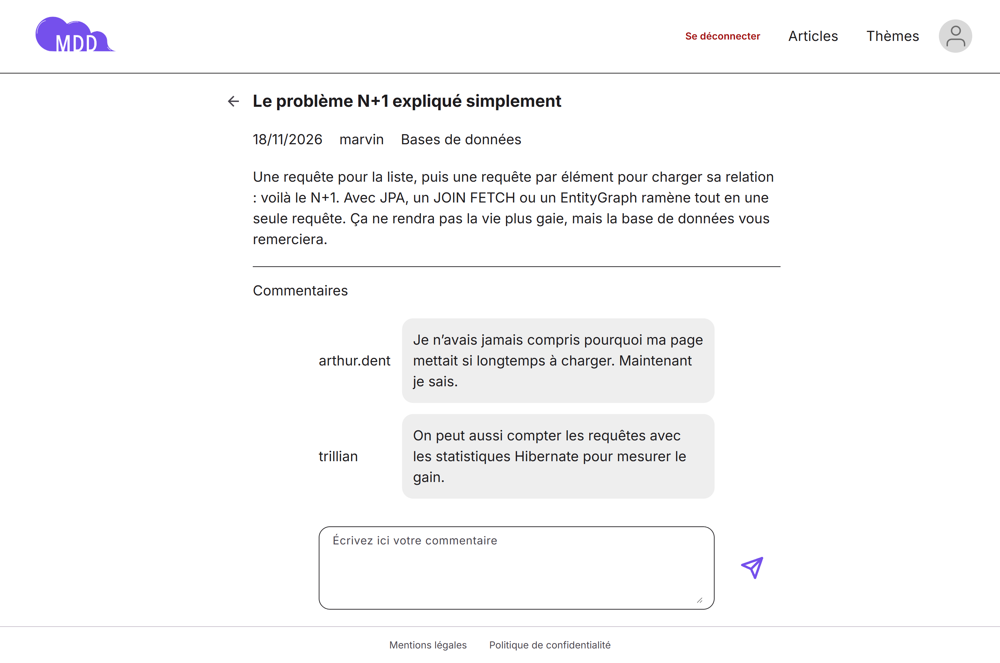

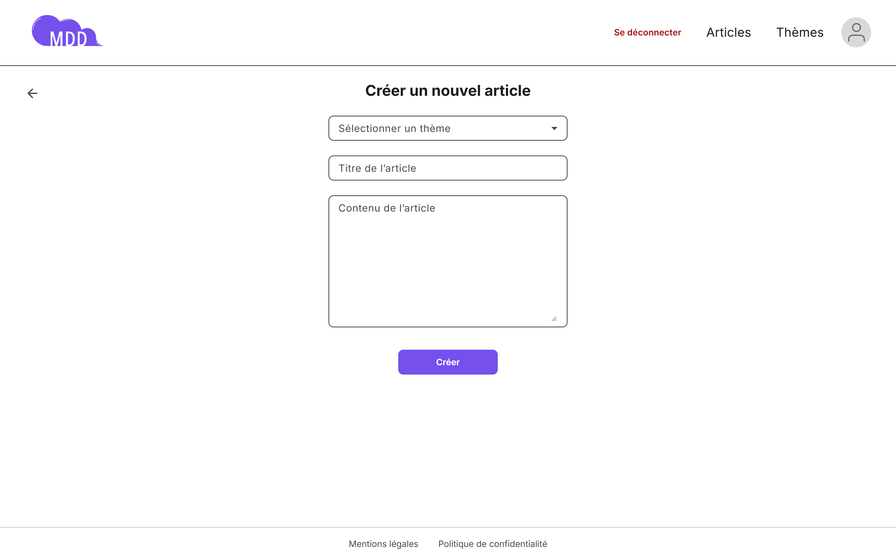

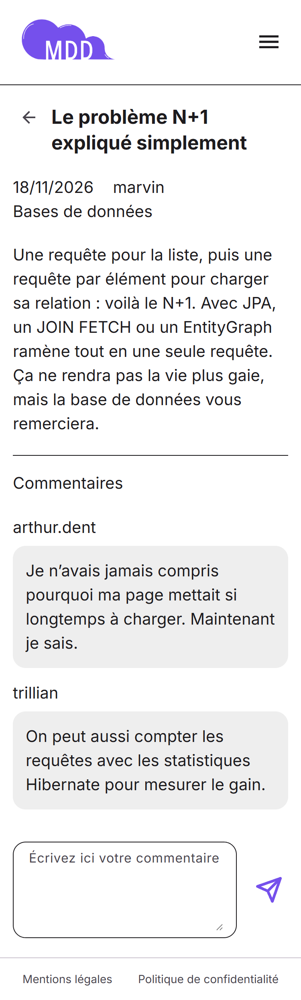 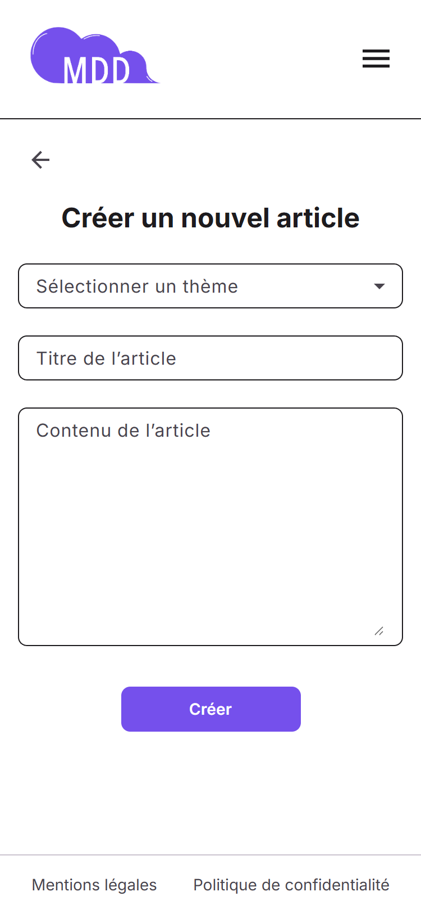

## Thèmes et profil

Composant `Topics`, qui affiche une carte `TopicCard` par thème ; composant `Profile`, qui réunit `ProfileForm`, `PasswordForm`, `DeleteAccount` et `Subscriptions`, lequel réutilise `TopicCard` pour les thèmes suivis.

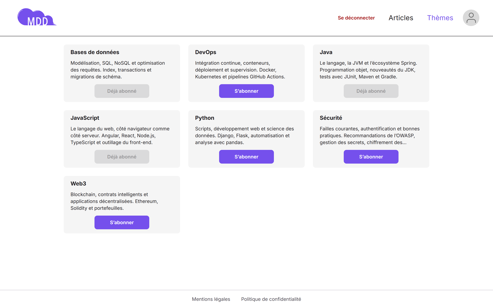

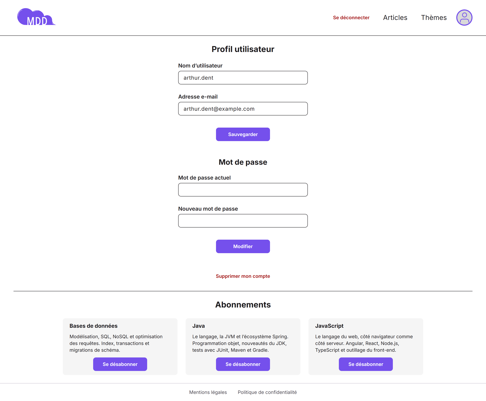

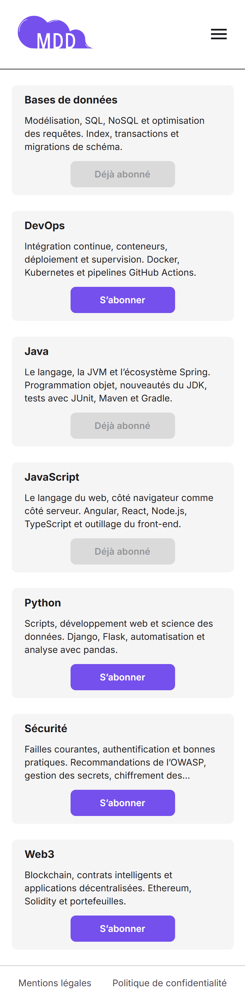 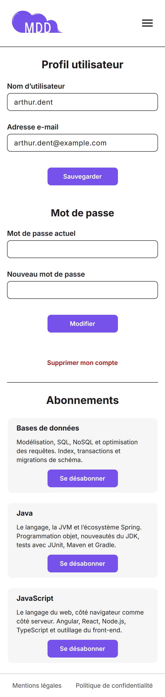

## Pages légales

Composants `PrivacyPolicy` et `LegalNotice`, dans la mise en page `LegalLayout` ; le pied de page `Footer` y mène depuis chaque page.

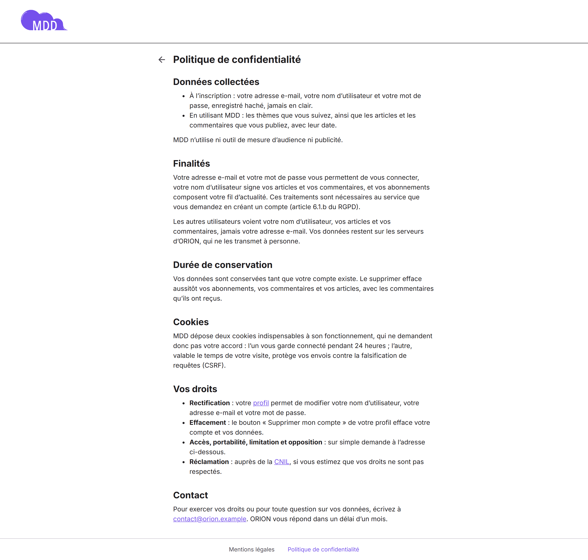