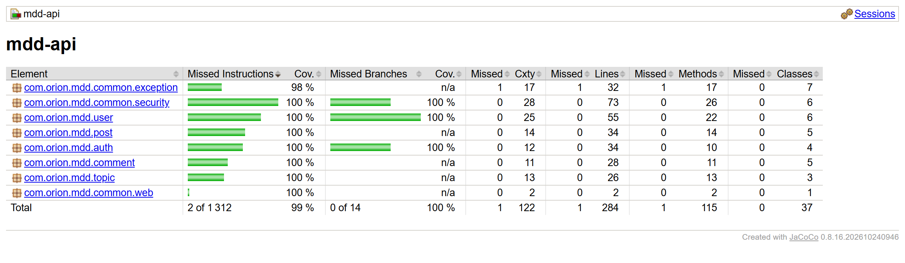
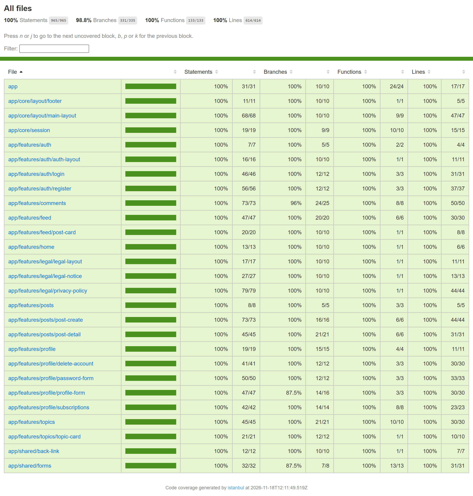

# Rapports de tests et de couverture

Annexe du document [Documentation et rapport du projet MDD](../documentation-projet.md).

Cette annexe a pour but de présenter les résultats des tests et de la couverture au 17/11/2026, ainsi que les anomalies que les tests ont révélées. La stratégie de test est décrite en 3.1.

## Résultats

- **Back-end** (`./mvnw verify`) : 104 tests réussis. 38 tests unitaires vérifient les règles des champs et des services ; 66 tests d’intégration appellent chaque endpoint jusqu’à un vrai MySQL 9.7.
- **Front-end** (`npm run test:coverage`) : 116 tests réussis dans 13 fichiers. 36 tests unitaires vérifient les règles des formulaires et la session ; 80 tests d’intégration ouvrent chacun une page dans la vraie application.
- **De bout en bout** (`npm run e2e:ci`) : 16 tests réussis dans 9 fichiers : accueil, inscription, connexion, profil, thèmes, articles, commentaires, pages légales et menu mobile.

## Couverture

- **Back-end** (JaCoCo) : 99,6 % des lignes (284 sur 285) et 100 % des branches. La seule ligne non couverte garde le premier message quand un même champ porte deux erreurs, un cas qu’aucun test ne provoque.
- **Front-end** (Vitest) : 100 % des lignes, 98,8 % des branches (331 sur 335). Les branches restantes sont des valeurs de repli qu’aucun cas réel n’atteint, comme une liste vide par défaut.

Sont exclus `MddApiApplication`, qui ne fait que démarrer l’application, le code généré par Lombok et les outils partagés des tests front-end (`src/testing`).

Les rapports détaillés se génèrent dans `back/target/site/jacoco/index.html` et `front/coverage/mdd-front/index.html`. Sous 80 % des lignes ou des branches, les deux commandes échouent, et l’intégration continue bloque la fusion de la pull request.

## Anomalies révélées par les tests

- **Tri du fil en minuscules** : `GET /api/feed?direction=desc` répondait 400, car Spring ne reconnaît le sens du tri qu’en majuscules. Un convertisseur accepte désormais les deux écritures.
- **Date arrondie par MySQL** : la réponse à la création d’un article donnait la date à la microseconde, alors que MySQL l’arrondit à la seconde ; relu ensuite, l’article pouvait avoir une seconde d’écart. Le back-end tronque maintenant la date à la seconde avant de l’enregistrer.
- **Commentaire publié mais annoncé en échec** : si la liste des commentaires n’avait pas pu se charger, y ajouter le nouveau commentaire levait une erreur, et la page signalait un échec alors que l’API l’avait enregistré. La page recharge désormais la liste dans ce cas.
- **Fil limité aux articles de l’utilisateur** : une première version de la requête du fil filtrait sur l’auteur au lieu des thèmes suivis. Les tests, où le lecteur et l’auteur sont deux comptes différents, l’ont refusée.

## Mise en œuvre

- **Base réelle** : Testcontainers lance MySQL 9.7 dans un conteneur, migrations Flyway comprises, si bien que les tests vérifient aussi les règles portées par la base, comme l’unicité et la suppression en cascade. Une base en mémoire comme H2 serait plus rapide, mais ne se comporte pas exactement comme MySQL.
- **Isolation** : chaque test d’intégration back-end s’exécute dans une transaction annulée à la fin, si bien qu’aucun ne voit les données d’un autre ; les tests Cypress tournent sur une base recréée à chaque lancement de l’API.
- **Nommage** : chaque nom de test décrit un comportement attendu, par exemple `refusesATopicTheUserDoesNotFollow`.
- **Mutations** : des modifications volontaires du code (une condition inversée, une ligne supprimée) ont vérifié que des tests échouent. L’une d’elles a fait ajouter un test pour le désabonnement d’un thème non suivi.
- **Intégration continue** : à chaque pull request, GitHub Actions relance sous Linux les tests, les seuils de couverture, la mise en forme et le lint. Seuls les tests Cypress, qui demandent la vraie API, se lancent à la main.