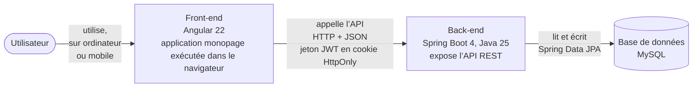
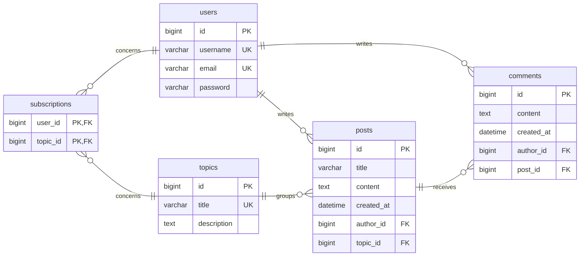

# Documentation et rapport du projet MDD

- **Auteur** : Lisa Bergeron
- **Version** : 0.1.0
- **Date** : 30/10/2026

## 1. Présentation générale du projet

### 1.1 Objectifs du projet

ORION, une entreprise spécialisée dans le développement logiciel, veut créer MDD (Monde de Dév), un réseau social destiné aux développeurs : il doit aider ceux qui cherchent un emploi grâce à la mise en relation et à la collaboration entre pairs. À terme, MDD pourrait devenir un vivier de recrutement pour les entreprises.

Avant de l’ouvrir à un large public, ORION souhaite le tester avec un MVP (Minimum Viable Product) déployé en interne, qui permet de s’abonner à des thèmes de programmation, de suivre un fil d’actualité, de publier des articles et de les commenter.

### 1.2 Périmètre fonctionnel

| Fonctionnalité | Description | Statut |
| --- | --- | --- |
| Page d’accueil | Accéder aux formulaires d’inscription et de connexion | À venir |
| Inscription | S’inscrire avec un e-mail, un nom d’utilisateur et un mot de passe | À venir |
| Connexion | Se connecter avec son e-mail, se déconnecter | À venir |
| Profil | Consulter et modifier son profil, supprimer son compte | À venir |
| Thème | Consulter la liste de tous les thèmes | À venir |
| Abonnement | S’abonner à un thème et s’en désabonner | À venir |
| Fil d’actualité | Consulter et trier son fil d’actualité | À venir |
| Article | Ajouter et consulter un article | À venir |
| Commentaire | Commenter un article | À venir |
| Pages légales | Consulter les mentions légales et la politique de confidentialité | À venir |
| Responsive | Utiliser l’application sur mobile comme sur ordinateur | À venir |

## 2. Architecture et conception technique

### 2.1 Schéma global de l’architecture



*Figure 1 : architecture client-serveur. Le MVP n’utilise aucun service tiers.*

#### Organisation du code

- **Dépôt** : un seul dépôt, trois dossiers `back/`, `front/` et `docs/`.
- **Front** : généré avec Angular CLI ; `core` (session, intercepteurs, protection des routes, bandeau, pied de page), `shared` (composants réutilisables) et `features` (`home`, `auth`, `profile`, `topics`, `feed`, `posts`, `legal`).
- **Back** : en couches (contrôleur → service → repository), rangé par fonctionnalité : `auth`, `user`, `topic` (thèmes et abonnements), `post` (articles et fil), `comment`, plus un dossier commun pour la sécurité, la configuration et la gestion des erreurs.

#### Conventions internes

- **Style** : le guide de style d’Angular et les conventions Java (nommage, Javadoc).
- **Langues** : code, commits, README et documentation pour les développeurs en anglais, le code reprenant les termes du glossaire des specs (`user`, `topic`, `post`, `comment`, `subscription`, `feed`) ; interface et livrables en français.
- **Git** : Git Flow (`main`, `develop`, branches `feature/*` et `docs/*`), Conventional Commits, fusion par pull request.
- **Outils** : Spotless met en forme le code Java, Prettier celui du front, et angular-eslint vérifie les bonnes pratiques d’Angular.

### 2.2 Choix techniques

Pour chaque choix structurant : type, documentation, objectif, justification et, s’il y a lieu, alternative écartée. Les outils de test et d’analyse sont présentés en 3.1 et 3.2.

#### Architecture

- **Organisation par fonctionnalité** (architecture du front-end et du back-end, [guide de style d’Angular](https://angular.dev/style-guide), [Spring Boot](https://docs.spring.io/spring-boot/reference/using/structuring-your-code.html))
  - **Objectif** : regrouper le code de chaque fonctionnalité.
  - **Justification** : le projet évoluera par ses fonctionnalités, et en ajouter une revient à ajouter un dossier ; une organisation recommandée par le guide de style d’Angular et montrée par la documentation de Spring Boot.
  - **Alternatives écartées** : un rangement par type de fichier (contrôleurs, services…), qui disperse chaque fonctionnalité ; des microservices, évoqués à la réunion de lancement, conçus pour que plusieurs équipes développent, déploient et dupliquent chacune son service ; avec une petite équipe et des données très liées (le fil d’actualité croise abonnements, articles et auteurs), ils ajouteraient des déploiements et des appels réseau sans contrepartie. Ils restent une évolution possible si MDD s’ouvre à un large public : rangé par fonctionnalité, le code permettra d’extraire un service à la fois.

#### Front-end

- **Angular 22** (framework front-end, [angular.dev](https://angular.dev))
  - **Objectif** : structurer l’application monopage et gérer la réactivité de l’interface.
  - **Justification** : dernière version stable, maintenue jusqu’au 30/06/2028 (Angular 19 ne l’est plus depuis le 19/05/2026), comme le recommande le [guide de sécurité d’Angular](https://angular.dev/best-practices/security) cité par les contraintes.
- **Signals** (gestion de l’état, [documentation](https://angular.dev/guide/signals))
  - **Objectif** : partager l’état et rafraîchir l’affichage quand il change.
  - **Justification** : intégrés à Angular ; seul l’utilisateur connecté est partagé entre les pages, qui chargent chacune leurs données.
  - **Alternative écartée** : NgRx Store, que [sa documentation](https://ngrx.io/guide/store/why) réserve à un état partagé par de nombreux composants, modifié depuis plusieurs endroits ou conservé d’une page à l’autre ; NgRx SignalStore, lui aussi fondé sur les signals, prendrait le relais si une évolution l’exigeait.
- **Angular Material** (bibliothèque de composants, [documentation](https://material.angular.dev))
  - **Objectif** : disposer de composants prêts à l’emploi, accessibles et personnalisables selon les maquettes.
  - **Justification** : déjà dans le projet de départ ; maintenue par l’équipe d’Angular, au même rythme de versions.
  - **Alternative écartée** : tout coder en CSS, en rendant soi-même chaque composant accessible.

#### Back-end

- **Java 25** (langage, [documentation](https://openjdk.org/projects/jdk/25/))
  - **Objectif** : langage du back-end.
  - **Justification** : version LTS, maintenue jusqu’en 2030 ou 2031 selon les fournisseurs, contre 2028 ou 2029 pour Java 21.
  - **Alternative écartée** : Java 27, maintenu six mois seulement.
- **Spring Boot 4, Spring Data JPA et Bean Validation** (framework back-end et modules, [Spring Boot](https://spring.io/projects/spring-boot), [Spring Data JPA](https://spring.io/projects/spring-data-jpa), [Bean Validation](https://docs.spring.io/spring-boot/reference/io/validation.html))
  - **Objectif** : construire l’API REST, accéder à la base sans écrire de SQL pour les opérations courantes, valider chaque requête.
  - **Justification** : les contraintes imposent Spring, demandent un module Spring Data et recommandent fortement Spring Boot, maintenu gratuitement jusqu’au 31/07/2027 en version 4.1 (la 3.5 ne l’est plus depuis le 30/06/2026). Les requêtes paramétrées empêchent l’injection SQL ; les règles de validation, déclarées sur les DTO, sont vérifiées par le back-end, qui reste la référence.
- **Flyway** (migrations du schéma, [documentation](https://documentation.red-gate.com/flyway))
  - **Objectif** : créer puis faire évoluer le schéma par des scripts SQL numérotés.
  - **Justification** : chaque évolution est rejouée à l’identique sur chaque poste et en production ; Hibernate vérifie seulement le schéma au démarrage (`spring.jpa.hibernate.ddl-auto=validate`).
  - **Alternatives écartées** : la génération du schéma par Hibernate, qui ne sait ni renommer ni supprimer et ne garde aucun historique ; Liquibase, conçu pour plusieurs bases quand MDD n’en a qu’une, et dont le retour arrière est remplacé ici par une migration corrective.
- **Records Java et Lombok** (réduction du code répétitif, [Lombok](https://projectlombok.org))
  - **Objectif** : ne pas écrire à la main constructeurs, getters et setters.
  - **Justification** : les DTO sont des records, construits depuis l’entité par une méthode `from` ; Lombok est réservé aux entités JPA, qui ne peuvent pas être des records.
  - **Alternative écartée** : MapStruct, superflu pour une dizaine de DTO.
- **springdoc-openapi** (documentation de l’API, [documentation](https://springdoc.org))
  - **Objectif** : générer depuis le code une documentation interactive de l’API (Swagger UI).
  - **Justification** : toujours à jour ; chaque endpoint s’essaie depuis le navigateur ; désactivée en production.
  - **Alternative écartée** : une collection Postman, à maintenir à la main.

#### Sécurité

- **Jeton JWT en cookie HttpOnly** (authentification, [RFC 7519](https://www.rfc-editor.org/rfc/rfc7519))
  - **Objectif** : reconnaître l’utilisateur à chaque appel et le garder connecté d’une session à l’autre.
  - **Justification** : sans état, le jeton laisse plusieurs instances du back-end répondre ; en cookie HttpOnly, il échappe aux scripts injectés (XSS) ; le CSRF est bloqué par un second jeton recopié en en-tête, comme le préconise le [guide de sécurité d’Angular](https://angular.dev/best-practices/security), et par l’attribut SameSite=Strict. Valable 24 heures, il ne peut pas être révoqué avant : une limite acceptable pour un MVP interne.
  - **Alternatives écartées** : le localStorage, lisible par tout script de la page ; une session côté serveur, que toutes les instances du back-end devraient partager.
- **Spring Security, module OAuth2 Resource Server** (sécurité, [documentation](https://docs.spring.io/spring-security/reference/servlet/oauth2/resource-server/jwt.html))
  - **Objectif** : signer et vérifier les jetons, protéger les routes.
  - **Justification** : module de Spring, que les contraintes font passer en premier ; signature et expiration vérifiées par le framework, avec une clé HS256 lue dans une variable d’environnement, suffisante puisque le même back-end signe et vérifie.
  - **Alternative écartée** : la bibliothèque JJWT, hors de Spring, qui oblige à écrire le filtre de vérification.
- **Argon2id** (hachage des mots de passe, [documentation](https://docs.spring.io/spring-security/reference/features/authentication/password-storage.html))
  - **Objectif** : ne jamais stocker un mot de passe en clair.
  - **Justification** : premier choix de l’[OWASP](https://cheatsheetseries.owasp.org/cheatsheets/Password_Storage_Cheat_Sheet.html), réglé sur ses paramètres minimaux (19 Mio de mémoire, 2 itérations, 1 fil d’exécution) ; la mémoire exigée à chaque essai freine les attaques sur cartes graphiques. Calcul confié à Bouncy Castle ; l’algorithme, noté avec chaque hachage, pourra changer sans invalider les comptes.
  - **Alternative écartée** : BCrypt, sans dépendance supplémentaire, mais que l’OWASP réserve aux applications existantes, et limité à 72 octets.

#### Données

- **MySQL 9.7 LTS et Spring Boot Docker Compose** (base de données, [MySQL](https://dev.mysql.com/doc/), [Docker Compose](https://docs.spring.io/spring-boot/reference/features/dev-services.html))
  - **Objectif** : stocker les données relationnelles, sans installer MySQL sur les postes.
  - **Justification** : déjà dans le projet de départ ; version LTS, maintenue jusqu’au 30/04/2031 ; Spring Boot démarre le conteneur Docker et s’y connecte seul, les secrets venant d’un fichier `.env` ignoré par Git.
  - **Alternative écartée** : installer MySQL sur chaque poste, au risque de versions différentes.
- **Table de liaison pour les abonnements** (modèle de données, [Définition des données](annexes/definition-donnees.md))
  - **Objectif** : enregistrer qui suit quel thème.
  - **Justification** : les specs ne prêtent aucune donnée à un abonnement, donc une table à clé primaire composée suffit, sans classe Java ; si une donnée devenait utile, comme la date, une migration Flyway l’ajouterait sans perdre l’existant.
  - **Alternative écartée** : une entité Subscription dès maintenant, qui anticiperait une évolution non demandée.

### 2.3 API et schémas de données

#### Modèle de données



*Figure 2 : modèle de données (tables MySQL créées par Flyway). PK : clé primaire, FK : clé étrangère, UK : valeur unique.*

Un utilisateur ne s’abonne qu’une fois à un thème : la clé primaire de `subscriptions` est le couple (`user_id`, `topic_id`). Noms d’utilisateur, e-mails et titres de thème sont uniques. L’auteur et la date d’un article ou d’un commentaire sont fixés par le back-end, et supprimer un compte efface en cascade ses abonnements, ses commentaires et ses articles, commentaires compris. Formats et règles de validation : voir l’annexe [Définition des données](annexes/definition-donnees.md).

#### API

L’API REST, servie sous `/api`, échange du JSON. L’inscription et la connexion déposent le jeton JWT, valable 24 heures, dans le cookie HttpOnly `mdd_token` ; toutes les autres routes l’exigent. Chaque requête `POST`, `PUT` ou `DELETE` porte aussi l’en-tête `X-XSRF-TOKEN`, qu’Angular recopie depuis le cookie `XSRF-TOKEN`. Dans la liste, le corps de la requête figure entre parenthèses, la réponse après la flèche.

- **`POST /api/auth/register`** (`username`, `email`, `password`) : inscrit et connecte l’utilisateur → 201, profil et cookie.
- **`POST /api/auth/login`** (`email`, `password`) : connecte l’utilisateur → 200, profil et cookie.
- **`POST /api/auth/logout`** : déconnecte l’utilisateur → 204, cookie effacé.
- **`GET /api/users/me`** : renvoie le profil de l’utilisateur connecté → 200.
- **`PUT /api/users/me`** (`username`, `email`, `password` facultatif) : modifie le profil → 200, profil.
- **`DELETE /api/users/me`** : supprime le compte et ses données → 204, cookie effacé.
- **`GET /api/topics`** : liste les thèmes, en indiquant ceux que suit l’utilisateur → 200.
- **`PUT /api/topics/{id}/subscription`** : abonne l’utilisateur au thème → 204.
- **`DELETE /api/topics/{id}/subscription`** : désabonne l’utilisateur du thème → 204.
- **`GET /api/feed`** : renvoie le fil d’actualité, du plus récent au plus ancien, ou l’inverse avec `?direction=asc` → 200.
- **`POST /api/posts`** (`topicId`, `title`, `content`) : crée un article → 201, article.
- **`GET /api/posts/{id}`** : renvoie un article et ses commentaires → 200.
- **`POST /api/posts/{id}/comments`** (`content`) : commente l’article → 201, commentaire.

Exemple de connexion :

```http
POST /api/auth/login
Content-Type: application/json
Cookie: XSRF-TOKEN=8f3a2c51...
X-XSRF-TOKEN: 8f3a2c51...

{
  "email": "jdupont@example.com",
  "password": "Exemple-2026"
}
```

```http
HTTP/1.1 200 OK
Set-Cookie: mdd_token=eyJhbGciOiJIUzI1NiJ9...; Max-Age=86400; Path=/; Secure; HttpOnly; SameSite=Strict
Content-Type: application/json

{
  "id": 1,
  "username": "jdupont",
  "email": "jdupont@example.com"
}
```

Les erreurs suivent le format Problem Details (RFC 9457), que Spring produit sans bibliothèque supplémentaire :

- **400** : données invalides, avec le message de chaque champ en erreur.
- **401** : utilisateur non connecté, jeton expiré ou invalide ; à la connexion, identifiants incorrects, sans préciser lequel est faux.
- **403** : jeton CSRF absent ou incorrect.
- **404** : thème ou article introuvable.
- **409** : nom d’utilisateur ou e-mail déjà pris.

Exemple d’inscription avec un nom d’utilisateur déjà pris :

```http
HTTP/1.1 409 Conflict
Content-Type: application/problem+json

{
  "type": "about:blank",
  "title": "Conflict",
  "status": 409,
  "detail": "Ce nom d’utilisateur est déjà pris.",
  "instance": "/api/auth/register"
}
```

## 3. Tests, performance et qualité

### 3.1 Stratégie de test

Les tests de chaque fonctionnalité sont écrits avant son code (TDD) et suivent le schéma Arrange-Act-Assert. Ils vérifient ce que l’utilisateur attend, à travers l’API ou l’interface, plutôt que le détail du code.

- **Unitaires, back-end** : [JUnit](https://junit.org) et [Mockito](https://site.mockito.org). Portée : les règles des services, isolées de la base de données.
- **Intégration, back-end** : Spring Boot Test et [Testcontainers](https://testcontainers.com). Portée : chaque endpoint, de la requête à un vrai MySQL 9.7 lancé dans un conteneur, migrations Flyway comprises. Ces tests vérifient aussi les règles portées par la base, comme l’unicité et la suppression en cascade. Une base en mémoire comme H2 serait plus rapide, mais ne se comporte pas exactement comme MySQL.
- **Unitaires, front-end** : [Vitest](https://vitest.dev), proposé par défaut par Angular 22. Portée : un composant ou un service pris seul.
- **Intégration, front-end** : Vitest. Portée : une page dans la vraie application, avec ses routes, ses protections, ses intercepteurs et ses services ; seules les réponses de l’API sont simulées.
- **De bout en bout** : [Cypress](https://docs.cypress.io). Portée : les parcours complets de l’utilisateur dans le navigateur, sur la vraie API.

La couverture est contrôlée à 80 % des lignes et des branches, avec [JaCoCo](https://www.jacoco.org/jacoco/) pour le back-end et Vitest pour le front-end : en dessous de ce seuil, `./mvnw verify` et `npm run test:coverage` échouent. Sont exclus `MddApiApplication`, qui ne fait que démarrer l’application, et le code généré par Lombok.

*Résultats à compléter au fil du développement.*

<!-- Description des tests mis en place : unitaires, d’intégration, end-to-end, frameworks utilisés, taux de couverture. Tableau : type de test, outil / framework, portée, résultats. -->

### 3.2 Rapport de performance et optimisation

*À compléter au fil du développement.*

<!-- Description des actions menées pour améliorer la performance du code et du rendu : résultats d’audit (Lighthouse, SonarQube, etc.), points d’amélioration identifiés, actions correctives appliquées. -->

### 3.3 Revue technique

*À compléter au fil du développement.*

<!-- Synthèse critique du code : points forts (structure, modularité, lisibilité), points à améliorer (complexité, dette technique, sécurité), actions correctives appliquées. -->

## 4. Documentation utilisateur et supervision

### 4.1 FAQ utilisateur

*À compléter au fil du développement.*

<!-- Courte section d’aide destinée aux utilisateurs internes ou finaux. Format Question / Réponse. -->

### 4.2 Supervision et tâches déléguées à l’IA

*À compléter au fil du développement.*

<!-- Tâches confiées à l’IA et vérifications effectuées. -->

## 5. Annexes

- Captures d’écran de l’interface et des vues principales (à venir)
- [Analyse des besoins front-end](annexes/analyse-besoins-front-end.md)
- [Définition des données](annexes/definition-donnees.md)
- Rapports de couverture et de tests (à venir)
- Rapport de revue technique (à venir)