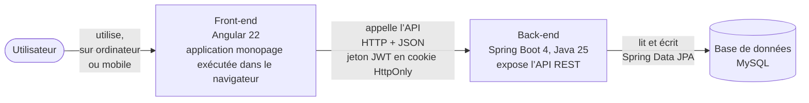
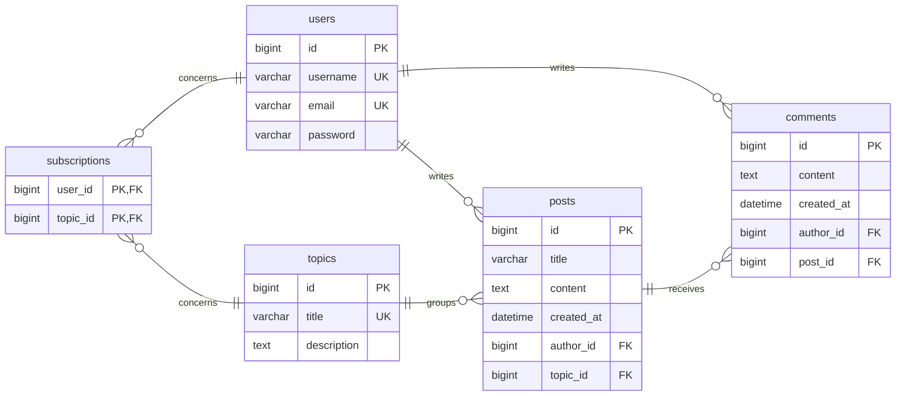

# Documentation et rapport du projet MDD

- **Auteur** : Lisa Bergeron
- **Version** : 1.0.0
- **Date** : 18/11/2026

## 1. Présentation générale du projet

### 1.1 Objectifs du projet

ORION, une entreprise spécialisée dans le développement logiciel, veut créer MDD (Monde de Dév), un réseau social destiné aux développeurs : il doit aider ceux qui cherchent un emploi grâce à la mise en relation et à la collaboration entre pairs. À terme, MDD pourrait devenir un vivier de recrutement pour les entreprises.

Avant de l’ouvrir à un large public, ORION souhaite le tester avec un MVP (Minimum Viable Product) déployé en interne, qui permet de s’abonner à des thèmes de programmation, de suivre un fil d’actualité, de publier des articles et de les commenter.

### 1.2 Périmètre fonctionnel

| Fonctionnalité | Description | Statut |
| --- | --- | --- |
| Page d’accueil | Accéder aux formulaires d’inscription et de connexion | ✅ Terminé |
| Inscription | S’inscrire avec un e-mail, un nom d’utilisateur et un mot de passe | ✅ Terminé |
| Connexion | Se connecter avec son e-mail, se déconnecter | ✅ Terminé |
| Profil | Consulter et modifier son profil, supprimer son compte | ✅ Terminé |
| Thème | Consulter la liste de tous les thèmes | ✅ Terminé |
| Abonnement | S’abonner à un thème et s’en désabonner | ✅ Terminé |
| Fil d’actualité | Consulter et trier son fil d’actualité | ✅ Terminé |
| Article | Ajouter et consulter un article | ✅ Terminé |
| Commentaire | Commenter un article | ✅ Terminé |
| Pages légales | Consulter les mentions légales et la politique de confidentialité | ✅ Terminé |
| Responsive | Utiliser l’application sur mobile comme sur ordinateur | ✅ Terminé |

## 2. Architecture et conception technique

### 2.1 Schéma global de l’architecture



*Figure 1 : architecture client-serveur. Le MVP n’utilise aucun service tiers.*

#### Organisation du code

- **Dépôt** : un seul dépôt, trois dossiers `back/`, `front/` et `docs/`.
- **Front** : généré avec Angular CLI ; `core` (session, protection des routes, bandeau, pied de page), `shared` (code réutilisé par plusieurs fonctionnalités) et `features` (`home`, `auth`, `profile`, `topics`, `feed`, `posts`, `comments`, `legal`).
- **Back** : en couches (contrôleur → service → repository), rangé par fonctionnalité : `auth`, `user`, `topic` (thèmes et abonnements), `post` (articles et fil), `comment`, plus un dossier commun pour la sécurité, la validation et la gestion des erreurs.

#### Conventions internes

- **Style** : le guide de style d’Angular, avec le type dans le nom de chaque fichier (`register.component.ts`, `session.service.ts`, `user.model.ts`), réglé dans `angular.json` pour `ng generate`, et les conventions Java (nommage, Javadoc).
- **Langues** : code, commits, README et documentation pour les développeurs en anglais, le code reprenant les termes du glossaire des specs (`user`, `topic`, `post`, `comment`, `subscription`, `feed`) ; interface et livrables en français.
- **Git** : Git Flow (`main`, `develop`, branches `feature/*` et `docs/*`), Conventional Commits, fusion par pull request.
- **Outils** : Spotless met en forme le code Java, Prettier celui du front, et angular-eslint vérifie les bonnes pratiques d’Angular.

### 2.2 Choix techniques

Pour chaque choix structurant : type, documentation, objectif, justification et, s’il y a lieu, alternative écartée. Les outils de test et d’analyse sont présentés en 3.1 et 3.2.

#### Architecture

- **Organisation par fonctionnalité** (architecture du front-end et du back-end, [guide de style d’Angular](https://angular.dev/style-guide), [Spring Boot](https://docs.spring.io/spring-boot/reference/using/structuring-your-code.html))
  - **Objectif** : regrouper le code de chaque fonctionnalité.
  - **Justification** : le projet évoluera par ses fonctionnalités, et en ajouter une revient à ajouter un dossier ; une organisation recommandée par le guide de style d’Angular et montrée par la documentation de Spring Boot.
  - **Alternatives écartées** : un rangement par type de fichier (contrôleurs, services…), qui disperse chaque fonctionnalité ; des microservices, évoqués à la réunion de lancement, conçus pour que plusieurs équipes développent, déploient et dupliquent chacune son service ; avec une petite équipe et des données très liées (le fil d’actualité croise abonnements, articles et auteurs), ils ajouteraient des déploiements et des appels réseau sans contrepartie. Ils restent une évolution possible si MDD s’ouvre à un large public : rangé par fonctionnalité, le code permettra d’extraire un service à la fois.

#### Front-end

- **Angular 22** (framework front-end, [angular.dev](https://angular.dev))
  - **Objectif** : structurer l’application monopage et gérer la réactivité de l’interface.
  - **Justification** : dernière version stable, maintenue jusqu’au 30/06/2028 (Angular 19 ne l’est plus depuis le 19/05/2026), comme le recommande le [guide de sécurité d’Angular](https://angular.dev/best-practices/security) cité par les contraintes.
- **Signals** (gestion de l’état, [documentation](https://angular.dev/guide/signals))
  - **Objectif** : partager l’état et rafraîchir l’affichage quand il change.
  - **Justification** : intégrés à Angular ; seul l’utilisateur connecté est partagé entre les pages, qui chargent chacune leurs données.
  - **Alternative écartée** : NgRx Store, que [sa documentation](https://ngrx.io/guide/store/why) réserve à un état partagé par de nombreux composants, modifié depuis plusieurs endroits ou conservé d’une page à l’autre ; NgRx SignalStore, lui aussi fondé sur les signals, prendrait le relais si une évolution l’exigeait.
- **Signal Forms** (formulaires, [documentation](https://angular.dev/guide/forms/signals/overview))
  - **Objectif** : décrire les champs, leur validation et leur envoi.
  - **Justification** : API stable depuis Angular 22, fondée sur les signals déjà retenus et prise en charge par Angular Material ; les erreurs renvoyées par l’API s’y rattachent aux champs concernés.
  - **Alternative écartée** : Reactive Forms, plus éprouvés, mais construits sur RxJS : deux modèles de réactivité dans les mêmes pages.
- **Angular Material** (bibliothèque de composants, [documentation](https://material.angular.dev))
  - **Objectif** : disposer de composants prêts à l’emploi, accessibles et personnalisables selon les maquettes.
  - **Justification** : déjà dans le projet de départ ; maintenue par l’équipe d’Angular, au même rythme de versions.
  - **Alternative écartée** : Tailwind CSS, qui colle vite aux maquettes, mais laisse à écrire le comportement et l’accessibilité des composants (liste déroulante, panneau latéral, fenêtre de confirmation).

#### Back-end

- **Java 25** (langage, [documentation](https://openjdk.org/projects/jdk/25/))
  - **Objectif** : langage du back-end.
  - **Justification** : version LTS, maintenue jusqu’en 2030 ou 2031 selon les fournisseurs, contre 2028 ou 2029 pour Java 21.
  - **Alternative écartée** : Java 27, maintenu six mois seulement.
- **Spring Boot 4, Spring Data JPA et Bean Validation** (framework back-end et modules, [Spring Boot](https://spring.io/projects/spring-boot), [Spring Data JPA](https://spring.io/projects/spring-data-jpa), [Bean Validation](https://docs.spring.io/spring-boot/reference/io/validation.html))
  - **Objectif** : construire l’API REST, accéder à la base sans écrire de SQL pour les opérations courantes, valider chaque requête.
  - **Justification** : les contraintes imposent Spring, demandent un module Spring Data et recommandent fortement Spring Boot, maintenu gratuitement jusqu’au 31/07/2027 en version 4.1 (la 3.5 ne l’est plus depuis le 30/06/2026). Les requêtes paramétrées empêchent l’injection SQL ; les règles de validation, déclarées sur les DTO, sont vérifiées par le back-end, qui reste la référence.
- **Flyway** (migrations du schéma, [documentation](https://documentation.red-gate.com/flyway))
  - **Objectif** : créer puis faire évoluer le schéma par des scripts SQL numérotés.
  - **Justification** : chaque évolution est rejouée à l’identique sur chaque poste et en production ; Hibernate vérifie seulement le schéma au démarrage (`spring.jpa.hibernate.ddl-auto=validate`).
  - **Alternatives écartées** : la génération du schéma par Hibernate, qui ne sait ni renommer ni supprimer et ne garde aucun historique ; Liquibase, conçu pour plusieurs bases quand MDD n’en a qu’une, et dont le retour arrière est remplacé ici par une migration corrective.
- **Records Java et Lombok** (réduction du code répétitif, [Lombok](https://projectlombok.org))
  - **Objectif** : ne pas écrire à la main constructeurs, getters et setters.
  - **Justification** : les DTO sont des records, construits depuis l’entité par une méthode `from` ; Lombok est réservé aux classes qui ne peuvent pas être des records : les entités JPA et les exceptions.
  - **Alternative écartée** : MapStruct, superflu pour une dizaine de DTO.
- **springdoc-openapi** (documentation de l’API, [documentation](https://springdoc.org))
  - **Objectif** : générer depuis le code une documentation interactive de l’API (Swagger UI).
  - **Justification** : toujours à jour ; chaque endpoint s’essaie depuis le navigateur ; désactivée en production.
  - **Alternative écartée** : une collection Postman, à maintenir à la main.

#### Sécurité

- **Jeton JWT en cookie HttpOnly** (authentification, [RFC 7519](https://www.rfc-editor.org/rfc/rfc7519))
  - **Objectif** : reconnaître l’utilisateur à chaque appel et le garder connecté d’une session à l’autre.
  - **Justification** : sans état, le jeton laisse plusieurs instances du back-end répondre ; en cookie HttpOnly, il échappe aux scripts injectés (XSS) ; le CSRF est bloqué par un second jeton recopié en en-tête, comme le préconise le [guide de sécurité d’Angular](https://angular.dev/best-practices/security), et par l’attribut SameSite=Strict. Valable 24 heures, il ne peut pas être révoqué avant : une limite acceptable pour un MVP interne, à lever avant une ouverture au public (voir 3.3).
  - **Alternatives écartées** : le localStorage, lisible par tout script de la page ; une session côté serveur, que toutes les instances du back-end devraient partager.
- **Spring Security, module OAuth2 Resource Server** (sécurité, [documentation](https://docs.spring.io/spring-security/reference/servlet/oauth2/resource-server/jwt.html))
  - **Objectif** : signer et vérifier les jetons, protéger les routes.
  - **Justification** : module de Spring, que les contraintes font passer en premier ; signature et expiration vérifiées par le framework, avec une clé HS256 lue dans une variable d’environnement, suffisante puisque le même back-end signe et vérifie.
  - **Alternative écartée** : la bibliothèque JJWT, hors de Spring, qui oblige à écrire le filtre de vérification.
- **Argon2id** (hachage des mots de passe, [documentation](https://docs.spring.io/spring-security/reference/features/authentication/password-storage.html))
  - **Objectif** : ne jamais stocker un mot de passe en clair.
  - **Justification** : premier choix de l’[OWASP](https://cheatsheetseries.owasp.org/cheatsheets/Password_Storage_Cheat_Sheet.html), réglé sur ses paramètres minimaux (19 Mio de mémoire, 2 itérations, 1 fil d’exécution) ; la mémoire exigée à chaque essai freine les attaques sur cartes graphiques. Calcul confié à Bouncy Castle ; l’algorithme, noté avec chaque hachage, pourra changer sans invalider les comptes.
  - **Alternative écartée** : BCrypt, sans dépendance supplémentaire, mais que l’OWASP réserve aux applications existantes, et limité à 72 octets.

#### Données

- **MySQL 9.7 LTS et Spring Boot Docker Compose** (base de données, [MySQL](https://dev.mysql.com/doc/), [Docker Compose](https://docs.spring.io/spring-boot/reference/features/dev-services.html))
  - **Objectif** : stocker les données relationnelles, sans installer MySQL sur les postes.
  - **Justification** : déjà dans le projet de départ ; version LTS, maintenue jusqu’au 30/04/2031 ; Spring Boot démarre le conteneur Docker et s’y connecte seul, les secrets venant d’un fichier `.env` ignoré par Git.
  - **Alternative écartée** : installer MySQL sur chaque poste, au risque de versions différentes.
- **Table de liaison pour les abonnements** (modèle de données, [Définition des données](annexes/definition-donnees.md))
  - **Objectif** : enregistrer qui suit quel thème.
  - **Justification** : les specs ne prêtent aucune donnée à un abonnement, donc une table à clé primaire composée suffit, sans classe Java ; si une donnée devenait utile, comme la date, une migration Flyway l’ajouterait sans perdre l’existant.
  - **Alternative écartée** : une entité Subscription dès maintenant, qui anticiperait une évolution non demandée.

### 2.3 API et schémas de données

#### Modèle de données



*Figure 2 : modèle de données (tables MySQL créées par Flyway). PK : clé primaire, FK : clé étrangère, UK : valeur unique.*

Un utilisateur ne s’abonne qu’une fois à un thème : la clé primaire de `subscriptions` est le couple (`user_id`, `topic_id`). Noms d’utilisateur, e-mails et titres de thème sont uniques. L’auteur et la date d’un article ou d’un commentaire sont fixés par le back-end, et supprimer un compte efface en cascade ses abonnements, ses commentaires et ses articles, commentaires compris. Formats et règles de validation : voir l’annexe [Définition des données](annexes/definition-donnees.md).

#### API

L’API REST, servie sous `/api`, échange du JSON. L’inscription et la connexion déposent le jeton JWT, valable 24 heures, dans le cookie HttpOnly `mdd_token`. Les routes `/api/auth` ignorent ce cookie, pour qu’un jeton devenu invalide n’empêche jamais de se reconnecter ; toutes les autres l’exigent. Chaque requête `POST`, `PUT` ou `DELETE` porte aussi l’en-tête `X-XSRF-TOKEN`, qu’Angular recopie depuis le cookie `XSRF-TOKEN`. Ce cookie arrive d’abord avec la réponse à `GET /api/users/me`, appelée au démarrage du front-end, même quand elle vaut 401. Dans la liste, le corps de la requête figure entre parenthèses, la réponse après la flèche.

- **`POST /api/auth/register`** (`username`, `email`, `password`) : inscrit et connecte l’utilisateur → 201, profil et cookie.
- **`POST /api/auth/login`** (`email`, `password`) : connecte l’utilisateur → 200, profil et cookie.
- **`POST /api/auth/logout`** : déconnecte l’utilisateur → 204, cookie effacé.
- **`GET /api/users/me`** : renvoie le profil de l’utilisateur connecté → 200.
- **`PUT /api/users/me`** (`username`, `email`) : modifie le profil → 200, profil.
- **`PUT /api/users/me/password`** (`currentPassword`, `newPassword`) : change le mot de passe après vérification de l’actuel → 204.
- **`DELETE /api/users/me`** : supprime le compte et ses données → 204, cookie effacé.
- **`GET /api/topics`** : liste les thèmes, en indiquant ceux que suit l’utilisateur → 200.
- **`PUT /api/topics/{id}/subscription`** : abonne l’utilisateur au thème → 204.
- **`DELETE /api/topics/{id}/subscription`** : désabonne l’utilisateur du thème → 204.
- **`GET /api/feed`** : renvoie le fil d’actualité, du plus récent au plus ancien, ou l’inverse avec `?direction=asc` → 200.
- **`POST /api/posts`** (`topicId`, `title`, `content`) : crée un article dans un thème que suit l’utilisateur → 201, article.
- **`GET /api/posts/{id}`** : renvoie un article → 200.
- **`GET /api/posts/{id}/comments`** : renvoie les commentaires de l’article, du plus ancien au plus récent → 200.
- **`POST /api/posts/{id}/comments`** (`content`) : commente l’article → 201, commentaire.

Exemple de connexion :

```http
POST /api/auth/login
Content-Type: application/json
Cookie: XSRF-TOKEN=8f3a2c51...
X-XSRF-TOKEN: 8f3a2c51...

{
  "email": "arthur.dent@example.com",
  "password": "Dont-Panic-42"
}
```

```http
HTTP/1.1 200 OK
Set-Cookie: mdd_token=eyJhbGciOiJIUzI1NiJ9...; Max-Age=86400; Path=/; Secure; HttpOnly; SameSite=Strict
Content-Type: application/json

{
  "id": 42,
  "username": "arthur.dent",
  "email": "arthur.dent@example.com"
}
```

Les erreurs suivent le format Problem Details (RFC 9457), que Spring produit sans bibliothèque supplémentaire :

- **400** : données invalides, avec le message de chaque champ en erreur dans `errors`.
- **401** : utilisateur non connecté, jeton expiré ou invalide ; à la connexion, identifiants incorrects, sans préciser lequel est faux.
- **403** : jeton CSRF absent ou incorrect.
- **404** : thème ou article introuvable.
- **409** : nom d’utilisateur ou e-mail déjà pris, avec le champ concerné dans `errors`.

## 3. Tests, performance et qualité

### 3.1 Stratégie de test

Les tests unitaires et d’intégration de chaque fonctionnalité sont écrits avant son code (TDD en boucle simple) ; les tests de bout en bout, écrits une fois la fonctionnalité terminée, vérifient ensuite le parcours complet. Tous suivent le schéma Arrange-Act-Assert. Ils vérifient ce que l’utilisateur attend, à travers l’API ou l’interface, plutôt que le détail du code. Résultats au 17/11/2026 :

- **Unitaires, back-end** : [JUnit](https://junit.org) et [Mockito](https://site.mockito.org), sur les règles des services et des champs, sans base de données. 38 tests réussis.
- **Intégration, back-end** : Spring Boot Test et [Testcontainers](https://testcontainers.com), sur chaque endpoint, jusqu’à un vrai MySQL 9.7. 66 tests réussis.
- **Unitaires, front-end** : [Vitest](https://vitest.dev), sur la session et les règles des formulaires, prises seules. 36 tests réussis.
- **Intégration, front-end** : Vitest, sur une page dans la vraie application, seules les réponses de l’API étant simulées. 80 tests réussis.
- **De bout en bout** : [Cypress](https://docs.cypress.io), sur les parcours complets dans le navigateur, avec la vraie API. 16 tests réussis.

La couverture est contrôlée à 80 % des lignes et des branches, avec [JaCoCo](https://www.jacoco.org/jacoco/) et Vitest : elle atteint 99,6 % des lignes et 100 % des branches pour le back-end, 100 % et 98,8 % pour le front-end. Une intégration continue ([GitHub Actions](https://docs.github.com/actions)) relance les tests et les seuils à chaque pull request. Détails, exclusions et anomalies révélées par les tests : annexe [Rapports de tests et de couverture](annexes/rapports-tests-couverture.md).

### 3.2 Rapport de performance et optimisation

#### Rendu : Lighthouse

[Lighthouse](https://developer.chrome.com/docs/lighthouse/overview), intégré aux outils de développement de Chrome, note une page de 0 à 100 sur quatre critères. Version 13.5, profil mobile, sur trois pages ; notes dans l’ordre performance, accessibilité, bonnes pratiques et référencement (SEO), avant puis après les corrections :

- **Accueil** : 75 → 100, 100, 96, 91 → 100.
- **Fil d’actualité** : 75 → 100, 100, 100, 91 → 100.
- **Article** : 75 → 100, 100, 100, 91 → 100.

Actions correctives :

- **Décalage de la mise en page** : tant que la page demandée se charge, la grille de l’application ne contient que le pied de page, qui s’affiche en haut de l’écran puis saute en bas. Placé d’office sur la dernière ligne de la grille, il ne bouge plus : le CLS (Cumulative Layout Shift) passe de 0,94 à 0 sur l’accueil et la performance de 75 à 100.
- **Référencement** : une description de l’application dans `index.html` et un fichier `robots.txt` qui autorise les moteurs de recherche font passer le SEO de 91 à 100.
- **Mesure sur la build de production** : `ng serve` joint à chaque fichier sa source map, si bien que Lighthouse mesure 1,76 Mo de JavaScript au lieu des 310 ko construits et le croit non minifié. Les audits portent donc sur la build de production, servie par `npm run preview`.

Seul écart conservé, la note de 96 en bonnes pratiques sur l’accueil : Lighthouse relève l’erreur 401 de `GET /api/users/me`, voulue, puisque c’est ainsi que le front-end apprend qu’aucun utilisateur n’est connecté.

#### Requêtes : chargement des relations

Sans précaution, Hibernate charge d’abord les articles, puis l’auteur et le thème de chacun par une requête séparée : une requête de plus par auteur et par thème différents. Avec `JOIN FETCH`, le fil d’actualité et la page d’un article sont chargés en une seule requête.

#### Qualité du code : SonarQube Cloud

[SonarQube Cloud](https://www.sonarsource.com/products/sonarqube/cloud/) analyse le code à chaque pull request. L’analyse du 17/11/2026 a relevé quatre problèmes ; après traitement, le quality gate est validé, sans bug ni faille, avec 1,2 % de code dupliqué.

- **`npm ci` sans `--ignore-scripts`** (sécurité, réel) : chaque dépendance peut exécuter un script à son installation ; si l’une d’elles était compromise, ce script s’exécuterait dans l’intégration continue. Corrigé : la CI installe désormais les dépendances sans leurs scripts.
- **Mot de passe écrit en dur** (sécurité, fausse alerte) : c’est celui des comptes jetables des tests Cypress, sur une base recréée à chaque lancement.
- **Deux tests sans assertion** (maintenabilité, fausses alertes) : `expectOne()` et `expectNone()` font échouer le test si la requête attendue n’est pas envoyée, mais Sonar ne les reconnaît pas comme des assertions.

Les trois fausses alertes sont marquées comme acceptées dans SonarQube Cloud, avec leur justification.

### 3.3 Revue technique

#### Points forts

- **Structure** : front-end et back-end rangés par fonctionnalité, en couches côté back-end.
- **Sécurité** : jeton en cookie HttpOnly, protection CSRF, mots de passe hachés avec Argon2id, requêtes paramétrées et erreurs au format Problem Details, sans détail technique.
- **Tests** : unitaires et d’intégration écrits avant le code, sur une vraie base MySQL, avec une couverture proche de 100 % (voir 3.1).
- **Qualité outillée** : mise en forme, lint, tests et couverture vérifiés à chaque pull request ; aucun bug ni faille selon SonarQube Cloud.

#### Actions correctives appliquées

Les anomalies révélées par les tests (voir 3.1) et par les audits (voir 3.2) ont été corrigées, et `develop` et `main` exigent désormais une intégration continue réussie avant toute fusion.

#### Améliorations à prévoir rapidement

- **Mot de passe redemandé** avant de changer d’e-mail ou de supprimer son compte.
- **Confirmation de la nouvelle adresse e-mail** par un lien envoyé à celle-ci.
- **Réinitialisation du mot de passe oublié** par un lien envoyé par e-mail.
- **Jeton révocable**, pour qu’une déconnexion ou un changement de mot de passe l’invalide.
- **Double abonnement simultané**, qui renvoie une erreur 500 au lieu d’un succès.
- **Mentions légales complètes** avant une ouverture au public.
- **Journal des événements** côté back-end, sans données personnelles.

Détails, évolutions et état des dépendances : annexe [Rapport de revue technique](annexes/rapport-revue-technique.md).

## 4. Documentation utilisateur et supervision

### 4.1 FAQ utilisateur

#### Compte et connexion

- **Comment créer un compte ?** Sur la page d’accueil, cliquez sur « S’inscrire », puis choisissez un nom d’utilisateur, votre adresse e-mail et un mot de passe. Vous êtes connecté dès l’inscription.
- **Quelles règles pour le nom d’utilisateur et le mot de passe ?** Le nom d’utilisateur compte de 3 à 30 caractères : lettres sans accent, chiffres, « . », « _ » ou « - ». Le mot de passe compte de 8 à 64 caractères, avec au moins un chiffre, une minuscule, une majuscule et un caractère spécial.
- **Comment me connecter ?** Sur la page d’accueil, cliquez sur « Se connecter », puis saisissez votre adresse e-mail et votre mot de passe. Vous restez connecté 24 heures, même si vous fermez le navigateur.
- **Comment me déconnecter ?** Cliquez sur « Se déconnecter » dans le bandeau, ou dans le menu ☰ sur mobile. Pensez-y sur un ordinateur partagé.
- **J’ai oublié mon mot de passe, que faire ?** MDD ne propose pas encore de réinitialisation. Écrivez à l’adresse indiquée dans la politique de confidentialité : ORION vous aidera à retrouver l’accès à votre compte.

#### Thèmes et fil d’actualité

- **Comment suivre un thème ?** Ouvrez la page « Thèmes » depuis le bandeau, puis cliquez sur « S’abonner » sous le thème choisi. Le bouton devient « Déjà abonné ».
- **Comment ne plus suivre un thème ?** Dans votre profil, la section des abonnements liste vos thèmes : cliquez sur « Se désabonner ».
- **Que montre le fil d’actualité ?** Les articles des thèmes que vous suivez, du plus récent au plus ancien. « Trier par » inverse cet ordre. Si le fil est vide, abonnez-vous d’abord à un thème.

#### Articles et commentaires

- **Comment publier un article ?** Depuis le fil d’actualité, cliquez sur « Créer un article », choisissez un thème (seuls ceux que vous suivez sont proposés : abonnez-vous d’abord depuis la page « Thèmes » si besoin), puis saisissez un titre et un contenu, et cliquez sur « Créer ». L’article s’ouvre aussitôt.
- **Comment commenter un article ?** Ouvrez l’article depuis le fil, écrivez votre commentaire dans le champ sous les commentaires existants, puis envoyez-le avec le bouton à côté du champ.
- **Puis-je modifier ou supprimer un article ou un commentaire ?** Pas dans cette version de MDD : relisez-vous avant de publier.

#### Profil

- **Comment modifier mon profil ?** Ouvrez votre profil depuis l’icône du bandeau. Modifiez votre nom d’utilisateur ou votre adresse e-mail, puis cliquez sur « Sauvegarder ». Pour changer de mot de passe, saisissez l’actuel et le nouveau, puis cliquez sur « Modifier ».
- **Comment supprimer mon compte ?** Dans votre profil, cliquez sur « Supprimer mon compte », puis confirmez. La suppression est définitive : vos abonnements, vos articles, avec leurs commentaires, et vos commentaires sont effacés.

#### Données personnelles et sécurité

- **Quelles données MDD conserve-t-il, et qui les voit ?** Votre adresse e-mail, votre nom d’utilisateur, votre mot de passe, vos abonnements, vos articles et vos commentaires. Les autres utilisateurs voient votre nom d’utilisateur, vos articles et vos commentaires, jamais votre adresse e-mail. Vos données restent chez ORION, qui ne les transmet à personne, et MDD n’utilise ni mesure d’audience ni publicité.
- **Mon mot de passe est-il protégé ?** Il n’est jamais enregistré en clair : MDD n’en garde qu’une empreinte, à partir de laquelle on ne peut pas le retrouver.
- **Comment exercer mes droits sur mes données ?** Votre profil permet de les corriger, et « Supprimer mon compte » de les effacer. Pour toute autre demande, écrivez à l’adresse indiquée dans la politique de confidentialité, accessible depuis le pied de page. ORION vous répond sous un mois.

### 4.2 Supervision et tâches réalisées avec l’assistance de l’IA

L’IA a tenu le rôle d’une équipe : proposer des options, rédiger de premières versions, relire et contredire. Chaque décision restait humaine : une première version était écrite sans l’IA, puis confrontée à la sienne avant de retenir la version finale.

Chaque échange avec l’IA suit une démarche encadrée :

- l’objectif, le périmètre et les contraintes sont définis en amont ;
- chaque proposition est relue et arbitrée, puis retenue, ajustée ou écartée ;
- tout code retenu passe les tests et les contrôles de l’intégration continue avant d’être fusionné ;
- les fonctionnalités situées hors du périmètre sont retenues en fonction de leur pertinence et si le temps le permet.

#### Tâches confiées

- **Analyse initiale** : passer en revue les consignes, établir le périmètre et les principaux jalons. Cette lecture a relevé des incohérences, comme Angular 19, recommandé par les consignes mais plus maintenu depuis mai 2026 ; les versions retenues sont justifiées en 2.2.
- **Choix techniques** : comparer plusieurs options avec leurs limites. Pour le hachage des mots de passe, BCrypt avait d’abord été retenu ; la comparaison a conduit à Argon2id, premier choix de l’OWASP pour une nouvelle application.
- **Code** : réaliser un brouillon, demander à l’IA sa propre version, fusionner les deux, puis faire une relecture.
- **Documentation** : proposer un squelette, puis relire une fois la rédaction du brouillon terminée ; rédiger aussi un premier jet des parties factuelles, comme les résultats des tests et la FAQ, ensuite relu, corrigé et réduit.
- **Diagnostic** : chercher la cause d’un problème et l’expliquer avant toute correction. Le fil d’actualité refusait le tri demandé en minuscules, parce que Spring n’accepte le sens du tri qu’en majuscules.

#### Constat

Outre quelques erreurs de diagnostic, l’IA va souvent plus loin, parfois même beaucoup plus loin, que la demande. Il est nécessaire de la ramener à l’essentiel. De même, il arrive qu’elle oublie des directives pourtant importantes comme le format de réponse attendu ou les limites imposées. Aucune solution pleinement efficace n’a été trouvée pour pallier cela.

## 5. Annexes

- [Captures d’écran de l’interface et des vues principales](annexes/captures-ecran.md)
- [Analyse des besoins front-end](annexes/analyse-besoins-front-end.md)
- [Définition des données](annexes/definition-donnees.md)
- [Rapports de tests et de couverture](annexes/rapports-tests-couverture.md)
- [Rapport de revue technique](annexes/rapport-revue-technique.md)